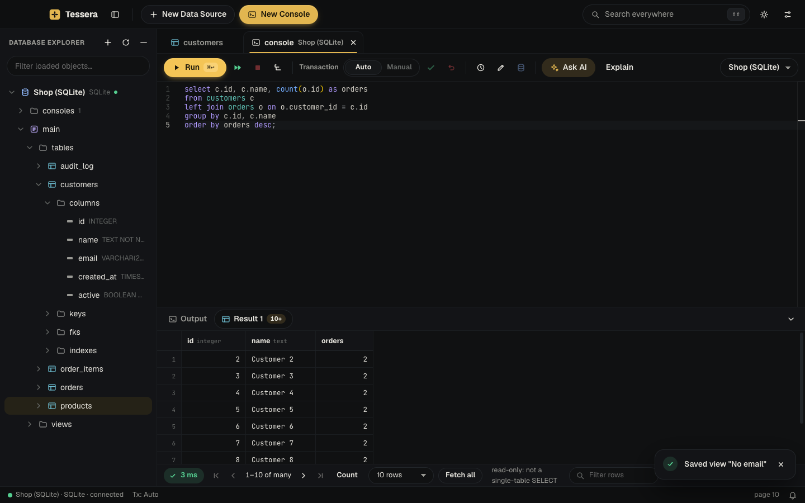
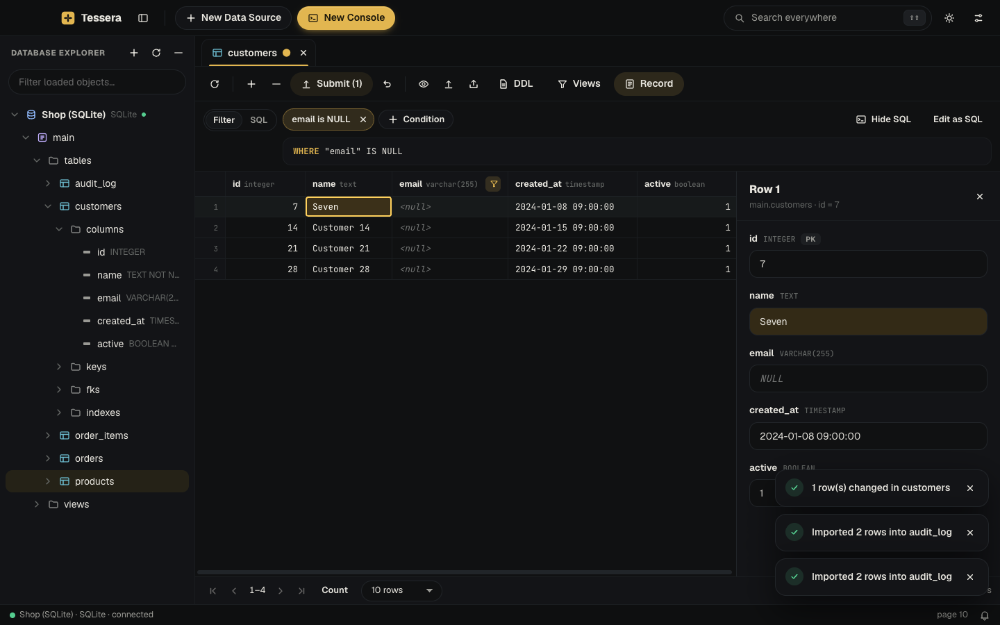
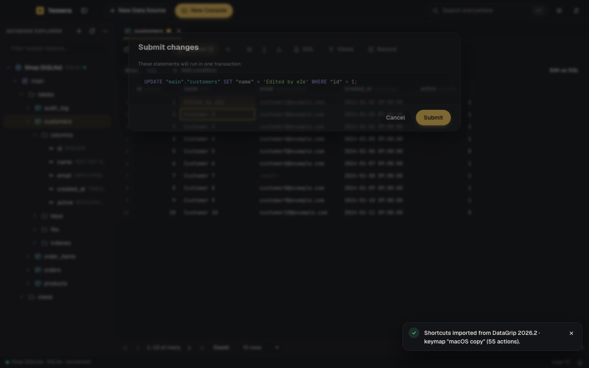
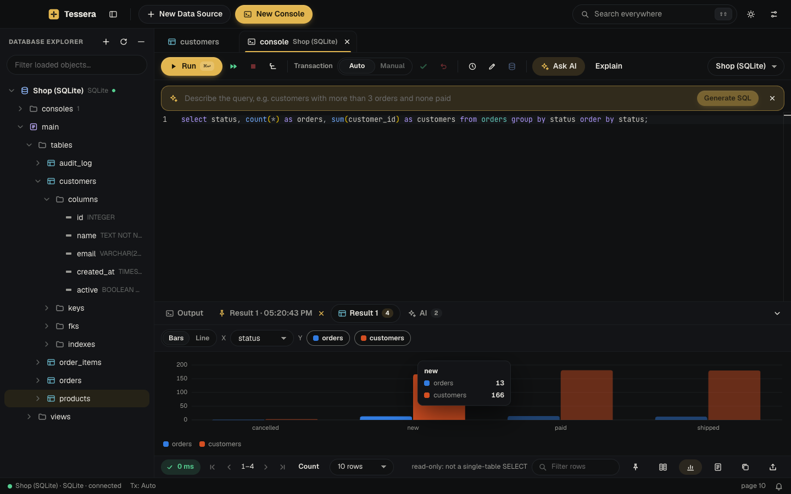
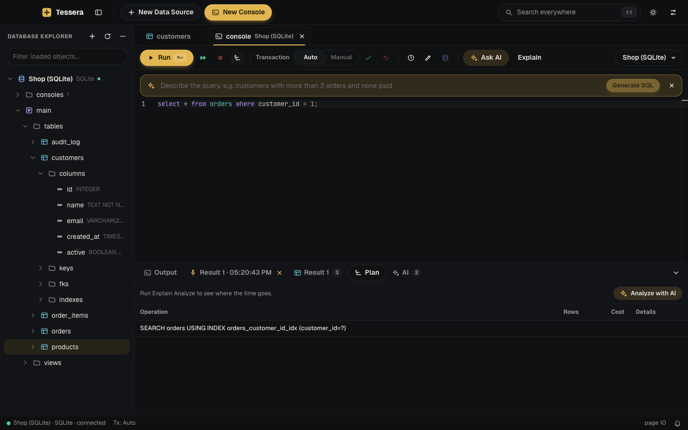
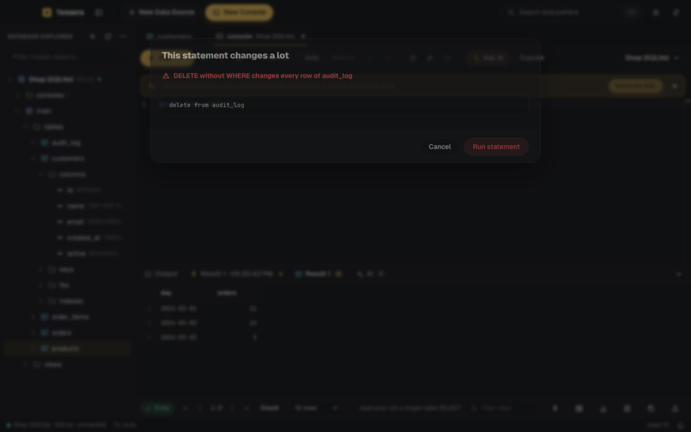
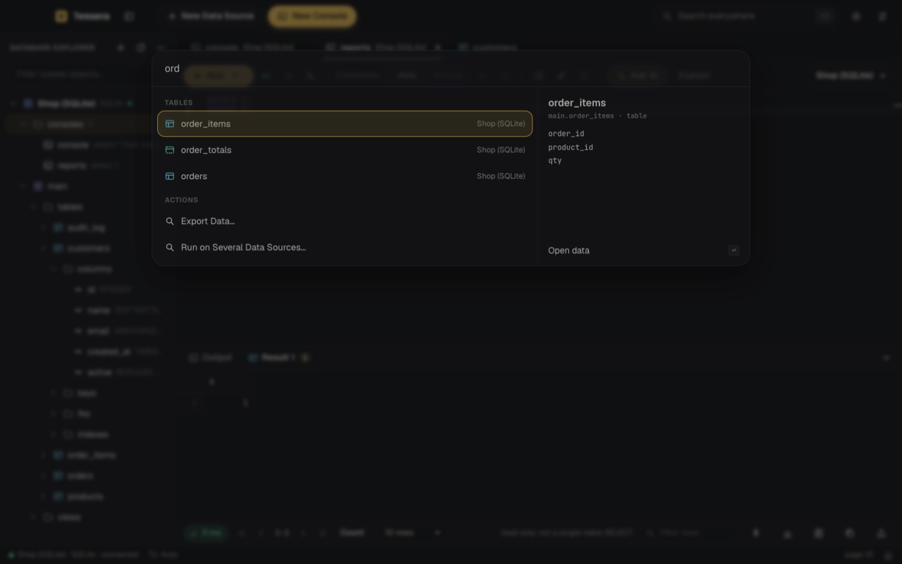

<div align="center">


# Tessera

**A desktop database IDE for the people who write SQL and the people who don't.**

Fast consoles with real completion, an editable grid you can trust, and production that is impossible to miss.
PostgreSQL · MySQL / MariaDB · SQLite

[](LICENSE)

[](https://github.com/loxt/tessera/releases/latest)


<br>

### Download

[**macOS (Apple Silicon)**](https://github.com/loxt/tessera/releases/latest/download/Tessera-mac-arm64.dmg) ·
[**macOS (Intel)**](https://github.com/loxt/tessera/releases/latest/download/Tessera-mac-x64.dmg) ·
[**Windows**](https://github.com/loxt/tessera/releases/latest/download/Tessera-Windows-Setup.exe) ·
[**Linux (AppImage)**](https://github.com/loxt/tessera/releases/latest/download/Tessera-Linux.AppImage) ·
[**Linux (.deb)**](https://github.com/loxt/tessera/releases/latest/download/Tessera-Linux.deb)

<sub>All versions on the <a href="https://github.com/loxt/tessera/releases">releases page</a>. First launch notes <a href="#first-launch">below</a>.</sub>

<br>



</div>

<br>

## Why Tessera

A *tessera* is one tile of a mosaic: every cell, placed with care. Tessera keeps the keyboard-first
workflow DataGrip users know (consoles, explicit transactions, DML preview before submit, even your
DataGrip keymap) and makes it approachable for the analysts, support and ops people who share the
same databases without living in SQL.

- **Keyboard first, never keyboard only.** Every action has a shortcut and a visible control.
- **Safe by default.** Edits are previewed as SQL, reversible until you submit, and production asks twice.
- **One tool, two fluencies.** Visual filters, a record form and charts sit on the same data as the SQL console.
- **The database as it is.** No hidden abstractions: you always see the statement that will run.

## Features

<table>
<tr>
<td width="50%" valign="top">

**Write SQL**
- Consoles with schema-aware completion: tables, columns, aliases, joins along foreign keys, ranked by your history
- A SQL highlighter that tells apart keywords, types, functions, tables, bind parameters, constants and casts
- Run the statement at the caret, a selection or the whole script; cancel anything
- Bind parameters (`:id`, `$1`, `?`), query history with search, snippets that expand with Tab
- Explain plans that show each step's own time and point at the hot spot
- Run one statement on several data sources at once

</td>
<td width="50%" valign="top">

**Work with data**
- A fast virtualized grid: edit cells, add, clone and delete rows, set NULL
- Select a range and type once to edit every cell, like DataGrip
- Edit the results of a single-table `SELECT` straight from the console
- Visual filters, saved views, a record form for the focused row, JSON viewer
- Import CSV, TSV and Excel; export CSV, TSV, JSON, SQL `INSERT` and Markdown
- Quick charts, pinned results to compare runs, relationship diagrams, schema diff

</td>
</tr>
<tr>
<td width="50%" valign="top">

**Stay safe**
- Data sources carry an environment (local, staging, production) with its own color everywhere
- Every change is shown as the exact parameterized SQL before it runs, in one transaction
- `UPDATE`/`DELETE` without `WHERE`, `DROP` and `TRUNCATE` ask first; in production you type the data source's name
- Read-only data sources are enforced by the server session
- Passwords are encrypted by the OS keychain (macOS Keychain, Windows DPAPI, Linux Secret Service); the UI never sees them

</td>
<td width="50%" valign="top">

**Feel at home**
- Imports your active DataGrip keymap on first launch, customizations included (macOS)
- Tessera Graphite and Paper themes, plus Catppuccin and Hardhacker
- Search Everywhere (⇧⇧) with a live preview of tables and consoles
- Split editors, persistent named consoles, sessions restored on restart
- An AI assistant through your local Claude Code login: it writes and explains SQL, and never runs it

</td>
</tr>
</table>

## A closer look

<table>
<tr>
<td width="50%"><p align="center"><sub>Visual filters and the record form</sub></p></td>
<td width="50%"><p align="center"><sub>Every change reviewed as SQL before it runs</sub></p></td>
</tr>
<tr>
<td width="50%"><p align="center"><sub>Quick charts from any result</sub></p></td>
<td width="50%"><p align="center"><sub>Explain plans that show where the time goes</sub></p></td>
</tr>
<tr>
<td width="50%"><p align="center"><sub>Guards for statements that can hurt</sub></p></td>
<td width="50%"><p align="center"><sub>Search Everywhere with previews</sub></p></td>
</tr>
</table>

## First launch

The installers are not signed with a paid developer certificate yet, so each OS asks once:

- **macOS**: open the `.dmg` and drag Tessera to Applications. If macOS says it cannot verify the app, go to
  **System Settings → Privacy & Security** and click **Open Anyway** (or run
  `xattr -dr com.apple.quarantine /Applications/Tessera.app`).
- **Windows**: if SmartScreen appears, click **More info → Run anyway**.
- **Linux**: `chmod +x Tessera-Linux.AppImage && ./Tessera-Linux.AppImage` (Ubuntu 22.04+ needs `libfuse2`),
  or `sudo apt install ./Tessera-Linux.deb`.

## Build from source

Requirements: Node.js 22+ and npm.

```bash
git clone https://github.com/loxt/tessera.git
cd tessera
npm install
npm run dev            # development with hot reload
npm run dist           # installers for the current OS → dist/
```

Releases are built by GitHub Actions: push a tag like `v0.2.0` and the
[release workflow](.github/workflows/release.yml) builds macOS, Windows and Linux installers and publishes them.

### AI assistant (optional)

Tessera drives the [Claude Code](https://docs.anthropic.com/en/docs/claude-code) CLI you already have
installed, with your own login. Tessera stores no API key, gives the model no tools, and never executes
what it writes: generated SQL lands in the console for you to read and run.

## Keyboard

Shortcuts are configurable in **Settings → Keymap**, with DataGrip-style contexts (Global, SQL Editor,
Data Grid). The defaults follow DataGrip's keymap; on Windows and Linux, ⌘ is Ctrl.

| Action | Keys |
|---|---|
| Search everywhere | ⇧⇧ |
| Find action | ⌘⇧A |
| New query console | ⌘⇧L |
| Execute statement at caret / selection | ⌘↩ |
| Execute script | ⌘⌥↩ |
| Commit | ⌘⌥⇧↩ |
| Query history | ⌘⌥E |
| Reformat SQL | ⌘⌥L |
| Data source properties | ⌘I |
| Refresh | ⌘⌥Y |
| Grid: add / clone / delete row, set NULL, value viewer, submit | ⌘N, ⌘D, ⌘⌫, ⌘⌥N, ⇧↩, ⌘↩ |

## Development

```bash
npm run db:up                  # PostgreSQL 17 + MySQL 8.4 in Docker, seeded from fixtures/
npm test                       # unit + integration tests (DB suites skip when a server is down)
npm run typecheck
npm run build && npm run e2e   # drives the real app with Playwright; refreshes docs/screenshots/
npm run db:down
```

### Architecture

```
src/shared/     domain model, typed IPC contract, action catalog, SQL lexer/splitter/params, DML, export
src/main/       Electron main: window, menu, IPC, Keychain-backed connection store,
                SessionManager (per-tab sessions, transactions), db/ adapters per engine
src/preload/    contextBridge → window.tessera (no Node in the renderer)
src/renderer/   React UI: explorer, consoles (Monaco), grid, dialogs, themes
e2e/            Playwright-for-Electron smoke test against SQLite, PostgreSQL and MySQL
```

Adding an engine means implementing `Adapter` in `src/main/db/<engine>.ts` and registering it in
`registry.ts`. More in [technical decisions](docs/architecture/technical-decisions.md) and the
[roadmap](docs/implementation/roadmap.md).

## Credits

- [Catppuccin](https://github.com/catppuccin/catppuccin) and [Hardhacker](https://github.com/hardhackerlabs/themes) color palettes (MIT)
- [Geist](https://vercel.com/font) and [JetBrains Mono](https://www.jetbrains.com/lp/mono/) fonts (SIL Open Font License)
- [Monaco Editor](https://github.com/microsoft/monaco-editor), [Electron](https://www.electronjs.org), [React](https://react.dev)

Tessera is an independent project. It is not affiliated with or endorsed by JetBrains; DataGrip is a
trademark of JetBrains s.r.o. and is mentioned only to describe keymap compatibility and familiar workflows.

## License

[MIT](LICENSE) © 2026 loxt
